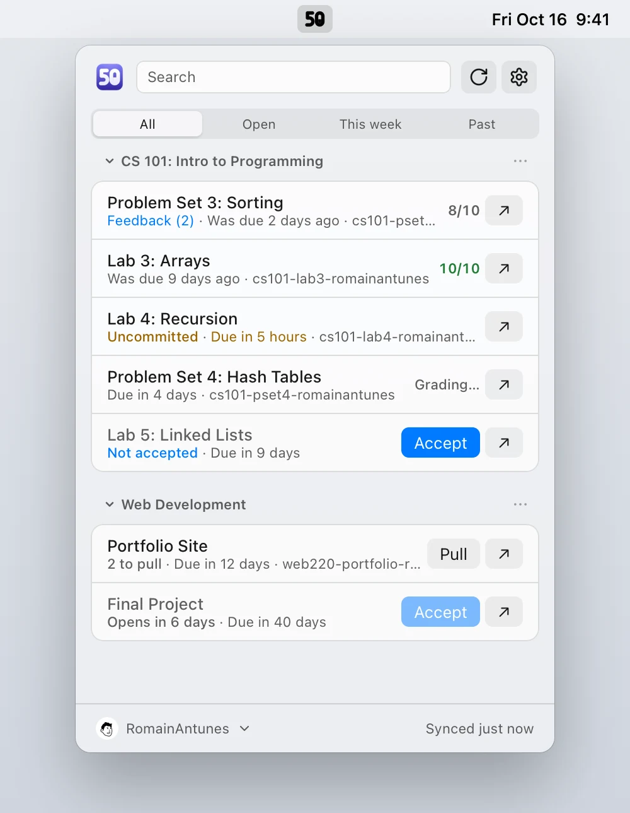
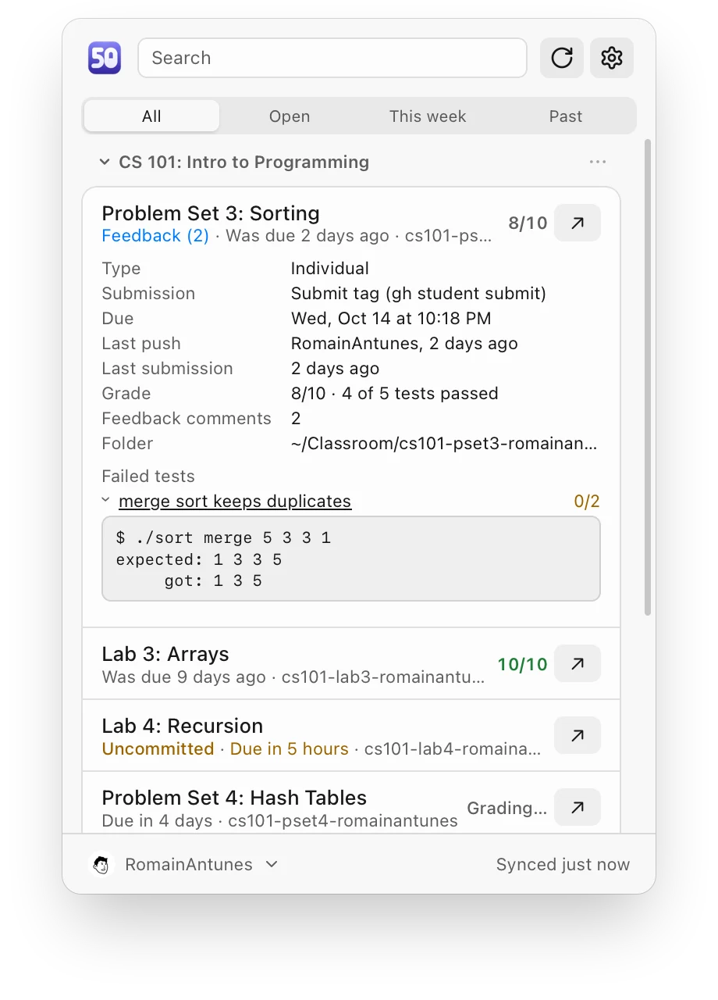
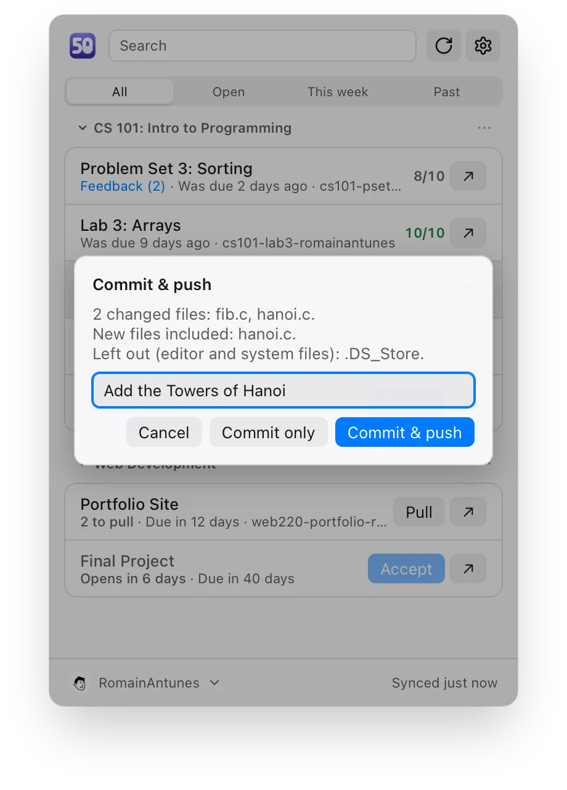
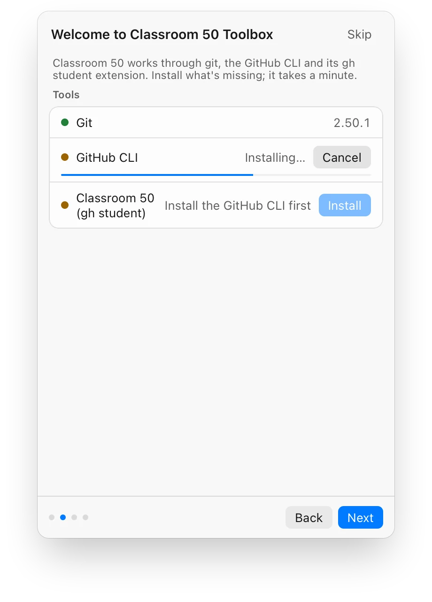
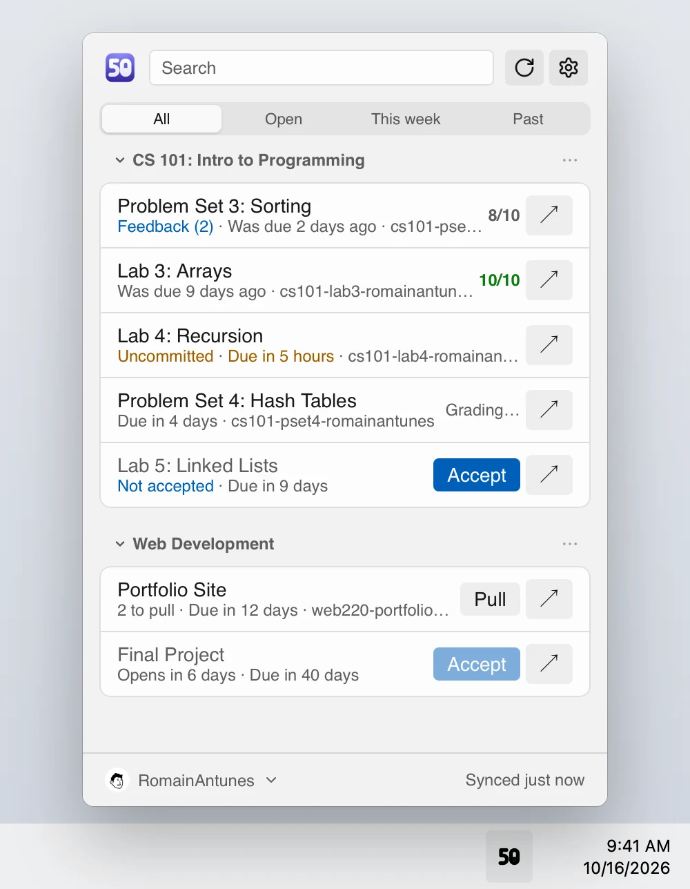
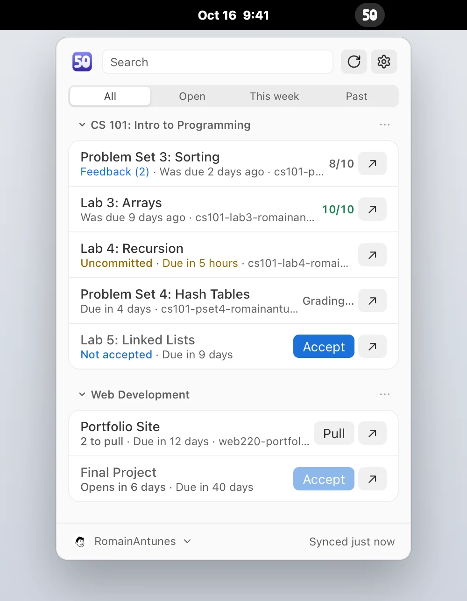

<div align="center">


# Classroom 50 Toolbox

**Your [Classroom 50](https://github.com/foundation50/classroom50) assignments, one click away.**<br />
Due dates, grades and the tests that failed, in your menu bar or notification area.<br />
Accept, clone, commit and submit with a button instead of a command.

[**Download**](https://romainantunes.github.io/classroom50-toolbox/) ·
[Latest release](https://github.com/RomainAntunes/classroom50-toolbox/releases/latest) ·
[Report a problem](https://github.com/RomainAntunes/classroom50-toolbox/issues)

[](https://github.com/RomainAntunes/classroom50-toolbox/releases/latest)

[](LICENSE)

<picture>
  <source srcset="site/screenshots/list-macos-dark.webp" media="(prefers-color-scheme: dark)" />
  
</picture>

</div>

A tray app for Classroom 50 students, in the spirit of JetBrains Toolbox. It installs what
Classroom 50 needs, finds your assignments, and runs the `gh student`, `gh` and `git` commands
for you when you click. Free, open source and not affiliated with the Fifty Foundation.

## A quick tour

<table>
  <tr>
    <td width="33%" valign="top">
      <picture>
        <source srcset="site/screenshots/popover-details-dark.webp" media="(prefers-color-scheme: dark)" />
        
      </picture>
      <p><b>See why a test failed.</b> The score, every test, and the autograder's output for
      the ones that didn't pass.</p>
    </td>
    <td width="33%" valign="top">
      <picture>
        <source srcset="site/screenshots/popover-commit-dark.webp" media="(prefers-color-scheme: dark)" />
        
      </picture>
      <p><b>Commit and push from the list.</b> It names the files and leaves out
      <code>.DS_Store</code> and editor folders. Off until you turn it on.</p>
    </td>
    <td width="33%" valign="top">
      <picture>
        <source srcset="site/screenshots/popover-setup-dark.webp" media="(prefers-color-scheme: dark)" />
        
      </picture>
      <p><b>Ready in a minute.</b> The first launch installs git, the GitHub CLI and
      <code>gh student</code>, then signs you in.</p>
    </td>
  </tr>
</table>

It follows each system's look, in light and dark:

<table>
  <tr>
    <td width="33%" align="center">
      <picture>
        <source srcset="site/screenshots/list-macos-dark.webp" media="(prefers-color-scheme: dark)" />
        
      </picture>
      macOS
    </td>
    <td width="33%" align="center">
      <picture>
        <source srcset="site/screenshots/list-windows-dark.webp" media="(prefers-color-scheme: dark)" />
        
      </picture>
      Windows
    </td>
    <td width="33%" align="center">
      <picture>
        <source srcset="site/screenshots/list-linux-dark.webp" media="(prefers-color-scheme: dark)" />
        
      </picture>
      Linux
    </td>
  </tr>
</table>

<sub>Screenshots show made-up classes; `pnpm site:shots` makes them from the app's own UI.</sub>

## What it does

- **Sets up your machine.** Checks for git, the GitHub CLI (`gh`) and the `gh student`
  extension, installs whichever is missing through your package manager (Homebrew, winget,
  apt/dnf/pacman/zypper), and updates `gh student` when a new version is out.
- **Signs you in** to GitHub through `gh`, with a one-time code in your browser. Several
  accounts are supported; the app never keeps its own copy of your token.
- **Lists your assignments**, from GitHub and from the folders on your disk, including the
  projects your editor opened recently (JetBrains IDEs, VS Code and its forks such as Cursor,
  Zed, Sublime Text, Eclipse, NetBeans or Visual Studio): due dates, late work, uncommitted or
  unsubmitted changes, branches not merged yet, grades with the tests that failed and your
  earlier grades, the autograder running or failing, and teacher feedback.
- **Accepts, clones, pulls, commits, pushes and submits** your work, and opens a project in
  the editor you last used for it, your terminal, your file manager or on GitHub.
- **Shows your group** on team assignments, with who is in it, even before you accept. Add a
  classmate to your group, or invite one to your repository, from the app. Search finds
  assignments by teammate too.
- **Notifies you** before a deadline, when a grade or feedback arrives, when a new assignment is
  published, when a teammate pushes, and when a classmate joins your group.
- **Puts your due dates in your calendar**: the Calendar app on macOS, GNOME Calendar or
  KOrganizer on Linux, or an `.ics` file anywhere.
- **Hides what you don't need**: a hidden assignment leaves the list and sends no
  notifications, and search still finds it.
- Works with the keyboard and screen readers, starts at login hidden in the tray, and updates
  itself. The first launch walks you through setup.

## Install

Download the installer for your platform from the
[latest release](https://github.com/RomainAntunes/classroom50-toolbox/releases/latest):

| Platform              | File                                                                                |
| --------------------- | ----------------------------------------------------------------------------------- |
| macOS (Apple Silicon) | `_aarch64.dmg`                                                                      |
| macOS (Intel)         | `_x64.dmg`                                                                          |
| Windows               | `_x64-setup.exe` (or the `_x64_….msi`)                                              |
| Windows on Arm        | `_arm64-setup.exe` (or the `_arm64_….msi`)                                          |
| Linux                 | `_amd64.AppImage`, `_amd64.deb` (Debian, Ubuntu) or `.x86_64.rpm` (Fedora, RHEL)    |
| Linux on Arm          | `_aarch64.AppImage`, `_arm64.deb` (Debian, Ubuntu) or `.aarch64.rpm` (Fedora, RHEL) |

Builds aren't code-signed yet, so the first launch needs one extra step:

- **macOS:** open the app once, then go to System Settings › Privacy & Security and click
  **Open Anyway**.
- **Windows:** SmartScreen shows "Windows protected your PC": click **More info › Run anyway**.
- **Linux on GNOME:** tray icons need the AppIndicator extension (Ubuntu ships it).

After that the app updates itself.

## Getting started

1. Click the tray icon. A short guide installs git, `gh` or `gh student` if one is missing and
   signs you in with GitHub. Use the account your classes know you by.
2. Choose where clones go and which editor opens them.
3. Your classrooms and assignments appear. Accept one, clone it, and the row follows its state
   from then on. Projects you already cloned are found in the folders your editor opened
   recently; add other folders in Settings.

## Languages

The app follows your system's language, or the one you pick in Settings: English, French,
Spanish, German, Italian, Portuguese (Brazil and Portugal), Dutch, Polish, Turkish, Arabic,
Hebrew, Simplified Chinese, Japanese and Korean.

The Japanese, Korean, Turkish, Chinese, Arabic and Hebrew translations were made with AI and
haven't been reviewed by native speakers yet, so some wording may sound off. Corrections are
welcome: each language is one file in [`src/lib/i18n/`](src/lib/i18n) (`ja.json`, `ko.json`,
`tr.json`, `zh-Hans.json`, `ar.json`, `he.json`). Open a pull request with your changes, or an
issue quoting the text and what it should say.

## Privacy

The app talks to GitHub only, with the token `gh` already holds, and never sends data anywhere
else. It reads your repositories and never changes them on its own: accepting, cloning, pulling
and submitting only happen when you click.

## Support the project

The toolbox is free and built by a student in their spare time. Its first goal is to pay for
code signing, so students no longer have to get past a security warning on first launch: the
Apple Developer Program costs 99 USD a year. If the toolbox helps you or your class,
[sponsoring it on GitHub](https://github.com/sponsors/RomainAntunes) gets it there faster.
Starring the repo and telling other students and teachers about it helps too.

## Develop

Requirements: [Rust](https://rustup.rs), Node.js LTS, pnpm, and the
[Tauri prerequisites](https://v2.tauri.app/start/prerequisites/) for your OS.

```sh
pnpm install
pnpm tauri dev      # run the app
pnpm lint           # prettier + svelte-check
pnpm test:e2e       # UI flows in WebKit, with Rust mocked
pnpm site:shots     # the screenshots above (needs cwebp)
cd src-tauri && cargo test && cargo clippy --all-targets -- -D warnings
```

Development builds never write to GitHub: accepting, submitting and pushing are refused, so you
can run them against your real classes safely.

## License

[GPL-3.0](LICENSE), like Classroom 50 itself.
